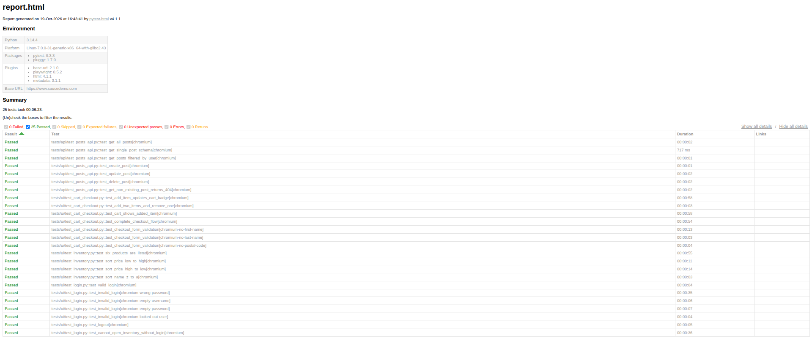

# QA Automation Framework


End-to-end test automation project covering a web application (UI) and a REST API, built with **Python, Playwright and pytest**. It includes manual test documentation, 25+ automated UI and API tests, HTML reports, and a CI pipeline on GitHub Actions.


## Applications under test

- UI: [SauceDemo](https://www.saucedemo.com), a public demo e-commerce site
- API: [JSONPlaceholder](https://jsonplaceholder.typicode.com), a free fake REST API

## What is covered

| Area      | Tests                                                                          |
|-----------|--------------------------------------------------------------------------------|
| Login     | valid login, 4 invalid-login cases, locked-out user, direct URL access, logout |
| Inventory | product count, sort by price and name                                          |
| Cart      | add, remove, badge count, cart contents                                        |
| Checkout  | full purchase flow, 3 form-validation cases                                    |
| API       | GET (all, single, filtered), POST, PUT, DELETE, 404 handling, schema check     |

## Tech stack

- Python 3.10+
- Playwright (browser automation) with the Page Object Model
- pytest, pytest-html (reports), requests (API)
- GitHub Actions (CI)

## Project structure

```
QA-Automation-Framework/
├── .github/workflows/tests.yml   # CI pipeline
├── docs/
│   ├── test_plan.md
│   ├── test_cases.md             # manual test cases
│   └── bug_report_template.md
├── pages/                        # Page Object classes
├── tests/
│   ├── ui/                       # UI tests
│   └── api/                      # API tests
├── conftest.py                   # shared fixtures
├── config.py                     # test data
├── pytest.ini
└── requirements.txt
```

## Setup

```bash
git clone https://github.com/theumeshshelke/QA-Automation-Framework.git
cd QA-Automation-Framework

python -m venv .venv
# Windows: .venv\Scripts\activate     Mac/Linux: source .venv/bin/activate

pip install -r requirements.txt
playwright install chromium
```

## Run the tests

```bash
pytest                      # everything
pytest -m smoke             # quick smoke suite
pytest -m api               # API tests only
pytest -m ui                # UI tests only
pytest --headed             # watch the browser
```

After a run, open `reports/report.html`. Screenshots of failed UI tests are saved in `test-results/`.

## Result



## Notes

- The demo sites are public, so occasional slowness can cause flaky failures.
- JSONPlaceholder only simulates writes, so POST, PUT and DELETE return success without saving data.

## Future improvements

- Cross-browser runs (Firefox, WebKit)
- Parallel execution with pytest-xdist
- Allure reporting